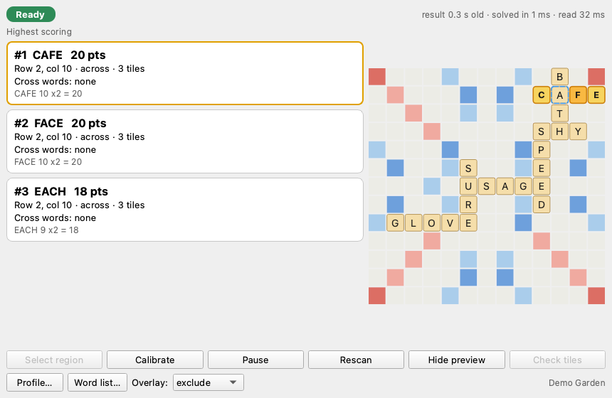
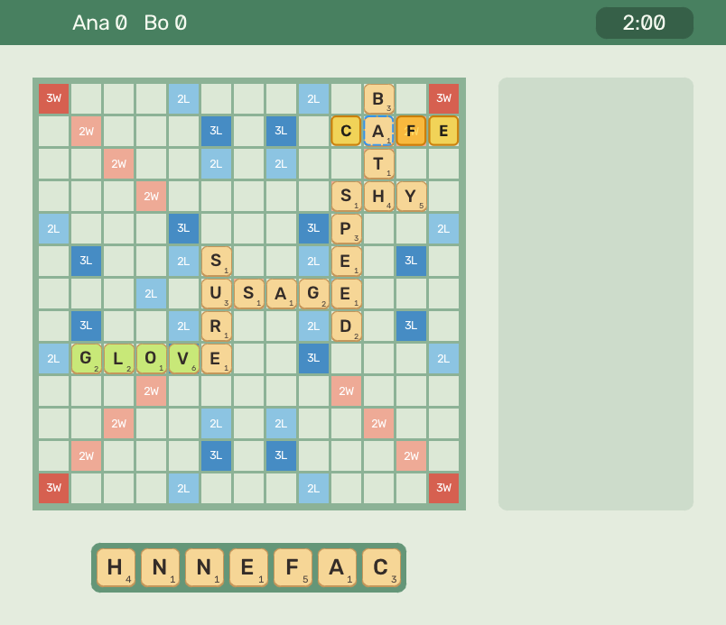
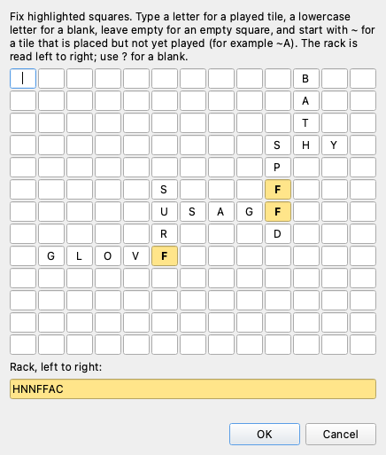

# TileLens

Screen-reading move finder for crossword-style tile games.

> TileLens is a fun side project for experimenting with computer vision and word search. It is fine for messing around with friends, but it is not meant for competitive or ranked play, and using assistance tools in online games can get your account banned. You are responsible for how and where you use it. This project is not affiliated with any game or company.

TileLens watches the part of your screen that shows a crossword-style tile board. It reads the
board and your rack, finds the three highest-scoring legal placements for this turn, and
previews them as ghost tiles over the game window. It never clicks or places anything, and
everything runs on your machine.





*All images come from TileLens's built-in fake game. No real game is shown.*

## How it works

1. **Capture.** A screen region you choose is captured 8 to 12 times a second (10 by default),
   and only while something changes. Frames stay in memory.
2. **Read.** The board grid is located, and each square is classified as empty or holding a
   tile by its colors and its glyph. Letters are matched against templates learned from your
   own screen during calibration. Uncertain squares go to a correction grid instead of being
   guessed.
3. **Confirm.** A position must read the same on three frames in a row. Tiles you have placed
   but not yet submitted show "Waiting for board".
4. **Search.** A word graph (DAWG) search runs in a separate process. It finds every legal
   placement and keeps the top three by score, with ties broken by coordinates. A result is
   shown only while the board on screen is still the position it was computed for.
5. **Preview.** A click-through overlay draws the selected placement. The overlay is hidden from
   screen capture, so TileLens never reads its own ghost tiles.

"Highest scoring" means the search finished; "best found so far" means it was cut short. A
result is only as exact as the board, rack, profile and word list it was given.

More detail: [vision](docs/vision.md), [live loop](docs/live-loop.md),
[panel and overlay](docs/overlay.md).

## Install

You need macOS on Apple silicon, [uv](https://docs.astral.sh/uv/) and Git.

```bash
git clone git@github.com:JMBugarin/tilelens.git
cd tilelens
uv run tilelens
```

`uv run` creates the environment from the lockfile on first use. To try it without a game:

```bash
uv run tilelens demo
```

That opens a self-playing fake game window next to the panel and needs no permissions.

### Screen Recording permission

macOS only lets apps read the screen with the Screen Recording permission.

```bash
uv run tilelens doctor
```

If it reports `denied`, open **System Settings > Privacy & Security > Screen & System Audio
Recording**, enable the terminal you run TileLens from, and reopen that terminal. Until then the
panel shows "Game not visible: Screen Recording permission is missing". See
[docs/manual-verification.md](docs/manual-verification.md).

## Calibration walkthrough


1. **Pick a profile.** Use a profile that describes your game (see below), then press
   **Profile…**.
2. **Choose a word list.** Press **Word list…** to pick yours (see below).
3. **Select the region.** Press **Select region** and drag around the game's board and rack.
4. **Calibrate.** Press **Calibrate**.
   - Drag a rectangle around the board grid. It only needs to be roughly right, or try
     **Guess rectangle**.
   - Type the board: one line per row, `.` for empty, uppercase for a tile, lowercase for a
     blank.
   - Type the rack from left to right, with `?` for a blank.
   - Use **Add this screen** and **Capture new screen** to add screens that show letters the
     first one did not.
5. **Play.** The panel shows Ready with up to three cards. Click a card to preview it on the
   board.

When something is unclear, the status turns to **Check tiles**. Open the grid, fix the
highlighted squares, and TileLens learns from the fix.



## Profile format

Every rule lives in a TOML profile: board size, premium squares, tile values and counts, rack
size, blanks, the full-rack bonus, how word premiums stack, where the first move must go, and
the word list path. No real game's profile ships with TileLens. These two are fictional:

```toml
format = "tilelens-profile"
version = 1
name = "Demo Pocket"

[board]
width = 9
height = 9
layout = [
  "T..d.d..T",
  ".D.....D.",
  "..+...+..",
  "d...t...d",
  "..q...q..",
  "d...t...d",
  "..+...+..",
  ".D.....D.",
  "T..d.d..T",
]

[board.legend]
d = "double_letter"
t = "triple_letter"
D = "double_word"
T = "triple_word"
q = { name = "quad_letter", letter = 4 }
"+" = { name = "double_both", letter = 2, word = 2 }

[rules]
start_squares = [[2, 2], [6, 6]]
word_premium_stacking = "add"

[rack]
size = 5
blanks = 1

[scoring]
full_rack_bonus = 25

[tiles.values]
A = 1
B = 3
# ...

[tiles.distribution]
A = 5
B = 1
# ...

[words]
path = "demo_words.txt"
```

Check a profile with `uv run tilelens check-profile my.toml`. Every key is described in
[docs/profile-format.md](docs/profile-format.md).

## Bring your own word list

TileLens includes no game's word list. The only list here is a 1,800-word list written by hand
for the demos. Import any UTF-8 file with one word per line:

```bash
uv run tilelens import-words ~/my-words.txt --profile my.toml
```

This filters the list to the profile's alphabet, saves it in the app data folder, builds the
search graph once and prints the path to put in the profile. Suggestions are only as good as the
list: if it differs from the game's dictionary, the game may reject a suggestion. See
[docs/word-lists.md](docs/word-lists.md).

## Measured performance

All numbers are from an Apple M5 Pro with 24 GB, macOS 26.6 and Python 3.13.16. The details
and the raw JSON are in [docs/performance.md](docs/performance.md).

### Search

On a 13x13 board with a 204k-word list:

| Case | Median | p95 | Worst |
| --- | ---: | ---: | ---: |
| Mid-game, 7 tiles | 2.2 ms | 6.2 ms | 7.1 ms |
| Dense board, 2 blanks | 17 ms | 95 ms | 118 ms |

### Recognition

On synthetic boards across five themes, including one held out from all tuning:

- 99.9–100% of squares are read correctly, and there were zero silent errors.
- 88–98% of rack tiles are read without help. The rest are flagged, never guessed.
- A frame takes about 25 ms to read.

### End to end

From a stable change in the fake game to the result in the panel:

- About 0.5 s median and 0.52 s worst in-process.
- About 0.5 s median in one real screen-capture run.
- Zero stale results were shown.

## Limits

- **Dictionary mismatch.** If your word list differs from the game's, suggestions can be words
  the game rejects, and some valid plays will be missing.
- **One visible window.** The board and rack must be visible in one captured region.
  Overlapping windows, a scrolled board or a hidden rack read as "Game not visible" or
  Check tiles.
- **Fixed grid.** TileLens assumes a flat grid of equal square cells that does not zoom or pan.
  Resizing the window holds results until you recalibrate.
- **Recognition is learned from your screen.** Letters you never calibrated or corrected are
  flagged until you confirm them once. Unusual tile effects, such as textures, gradients or
  heavy animation, are untested.
- **Tentative tiles.** A game that draws placed-but-unplayed tiles exactly like played ones
  cannot be told apart by color.
- **One turn only.** TileLens maximizes this turn's score, with no strategy, rack-leave
  evaluation or opponent modeling.
- **Real games are untested.** Only synthetic boards and the fake game window were tested.

## Privacy

Everything runs locally. TileLens makes no network requests at run time and has no telemetry,
accounts, API keys or cloud models. Captured frames stay in memory and are never written to
disk unless you press **Save debug dump**, which writes the current capture and what was read from it to `~/Library/Application Support/tilelens/debug_dumps`. Your settings, calibration, imported word lists and search-graph cache are stored in
`~/Library/Application Support/tilelens` and `~/Library/Caches/tilelens`.

## Platform support

| Platform | Status |
| --- | --- |
| macOS 26, Apple silicon | Tested (capture, overlay exclusion, permission handling) |
| Other macOS versions or Intel Macs | Untested |
| Windows | Unsupported. The platform adapter raises a clear "not supported" error. |
| Linux | Untested generic capture; no permission or overlay-exclusion handling |

Packaging into an unsigned `TileLens.app` is described in [packaging/README.md](packaging/README.md).

## Development

```bash
uv sync
uv run ruff check .
uv run ruff format --check .
uv run pytest -m "not gui and not slow"   # what CI runs on macOS and Ubuntu
uv run pytest                              # everything, including GUI and long randomized tests
```

Benchmarks live in `benchmarks/` and synthetic fixtures come from `src/tilelens/synth/`.

## License

MIT. See [LICENSE](LICENSE) and [THIRD_PARTY_NOTICES.md](THIRD_PARTY_NOTICES.md).
