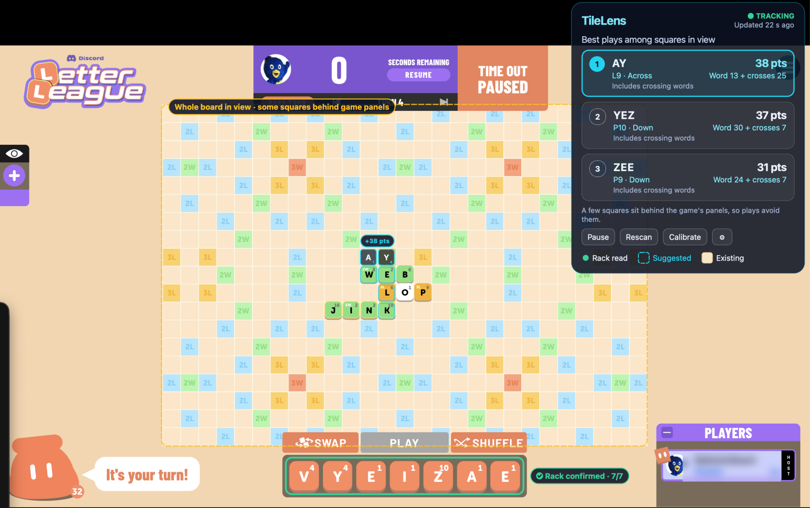
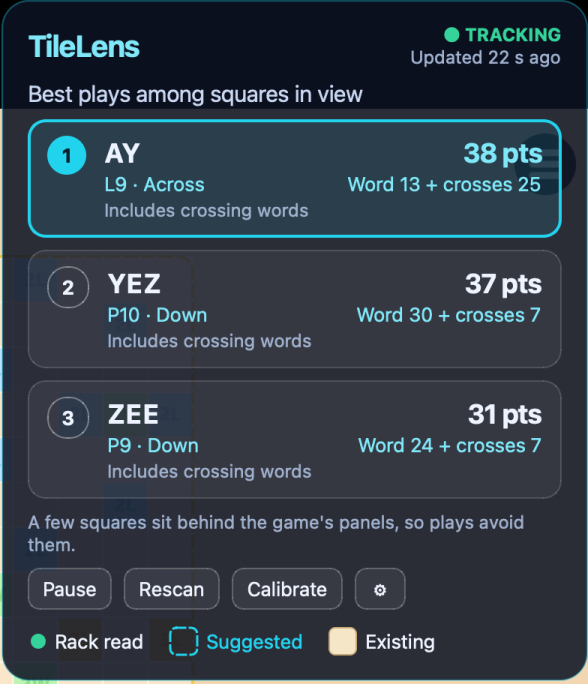

# TileLens

Screen-reading move finder for crossword-style tile games.

> TileLens is a fun side project for experimenting with computer vision and word search. It is fine for messing around with friends, but it is not meant for competitive or ranked play, and using assistance tools in online games can get your account banned. You are responsible for how and where you use it. This project is not affiliated with any game or company.

TileLens watches the part of your screen that shows a crossword-style tile board. It reads the
board and your rack, finds the three highest-scoring legal placements for this turn, and
previews them as ghost tiles over the game window. It never clicks or places anything, and
everything runs on your machine.



*TileLens running over Letter League in Discord: the rack is outlined green once every tile is
read, the selected play is previewed as dashed ghost tiles, and the panel ranks the top three
plays by total points. The player's name is blurred.*



## How it works

1. **Capture.** The whole display that shows the game is captured 8 to 12 times a second (10 by
   default), and only read when something changed. Frames stay in memory. TileLens's own windows
   are never part of a capture.
2. **Align.** The board is found from its square colors on every frame where it moved, so
   zooming, panning, resizing and fullscreen need no setup. When the board moves the preview is
   cleared at once and returns once the board is found again.
3. **Read.** Each square is classified as empty or holding a tile, and the rack is read tile by
   tile. Letters are matched against shapes learned from your own screen and, for letters not
   seen yet, against stock-font shapes, so a fresh install reads the rack without typing it.
   The point values printed on rack and board tiles are read too: Letter League counts the
   number printed on a played tile whenever it is used again, so scores follow the game's own.
4. **Settle.** A position must read the same on three frames in a row. Squares and rack tiles
   that read unclear are settled in this order: remembered tiles, then the word list (the
   next-best letter that makes every word through the square valid), then a lone-tile check.
   What is still unclear never stops the suggestions: an unclear square is treated as a wall
   and the panel names the tile and offers its best letters as buttons.
5. **Search.** A word graph (DAWG) search runs in a separate process. It finds every legal
   placement and keeps the top three by total score, premiums and crossing words included. A
   result is shown only while the board on screen is still the position it was computed for.
6. **Preview.** A click-through overlay draws the selected placement as ghost tiles. Clicking
   a card in the panel holds that play still while you place your tiles, and tracking resumes
   by itself when your rack refills. The overlay and the panel are hidden from screen capture.

"Highest scoring" means the search finished; "best found so far" means it was cut short. A
result is only as exact as the board, rack, profile and word list it was given.

More detail: [vision](docs/vision.md), [live loop](docs/live-loop.md),
[panel and overlay](docs/overlay.md).

## Install

You need macOS on Apple silicon, [uv](https://docs.astral.sh/uv/) and Git.

```bash
git clone git@github.com:JMBugarin/tilelens.git
cd tilelens
uv run tilelens
```

`uv run` creates the environment from the lockfile on first use. To try it without a game:

```bash
uv run tilelens demo
```

That opens a self-playing fake game window next to the panel and needs no permissions.

### Screen Recording permission

macOS only lets apps read the screen with the Screen Recording permission.

```bash
uv run tilelens doctor
```

If it reports `denied`, open **System Settings > Privacy & Security > Screen & System Audio
Recording**, enable the terminal you run TileLens from, and reopen that terminal. Until then the
panel shows "Game not visible: Screen Recording permission is missing". See
[docs/manual-verification.md](docs/manual-verification.md).

## Using it with Letter League in Discord

1. Start TileLens (`uv run tilelens`) and open the game in Discord, windowed, maximized or
   fullscreen. With a profile that has an `[appearance]` section (see below) there is nothing
   to calibrate: TileLens finds the board, reads the rack and learns the game's look from the
   first screen it sees, and the control window steps out of the way.
2. Play. The panel shows **Tracking** and the top three plays. The first play is previewed on
   the board; click another card to preview that one instead.
3. **Click a card to place it.** The ghost tiles freeze (the panel says **Holding**) so you can
   lay your tiles over them. When your rack is full again with new letters, TileLens reads it
   and resumes by itself. Click the card again, or **Resume tracking**, to let go early.
4. When someone else plays, the old suggestion is dropped at once and the position is searched
   again. Zooming or panning clears the preview and realigns it when the board is found.

The panel states and what to do:

| State | Meaning | What to do |
| --- | --- | --- |
| Tracking | Cards are current for the position on screen | Nothing |
| Aligning | The board moved and is being found again | Nothing |
| Reading rack | The rack or board is still changing | Nothing |
| Calculating | The search is running | Nothing |
| Holding | A card was clicked; the suggestion is frozen | Place your tiles |
| Check one tile | A tile cannot be worked around | Tap the letter it names |
| Board obscured | A menu, popup or window covers the board | Bring the board back into view |
| Paused | You paused tracking | Press Resume |

An unsure tile does not stop the cards: the panel says which tile and shows its best letters as
buttons, and one tap teaches TileLens that tile for good. **Calibrate** re-learns the game from
the screen without typing; only if the rack cannot be read does it open a dialog with the best
guess filled in. The ⚙ button opens the settings window, which is also in the menu bar.


If a play scores differently in the game than in TileLens, run
`uv run tilelens check-screen` while the game is on screen: it prints what was read, the
rack, the top plays and the time each step took. Tile values are read from the rack tiles
themselves and saved beside your profile (`<profile>.learned.json`).

### Without an `[appearance]` section

A profile without it cannot find the board by itself. Select the region, press **Calibrate**,
drag around the board grid, type the board and the rack, and use **Add this screen** to teach
more letters. See [docs/vision.md](docs/vision.md).

## Profile format

Every rule lives in a TOML profile: board size, premium squares, tile values and counts, rack
size, blanks, the full-rack bonus, how word premiums stack, where the first move must go, and
the word list path. No real game's profile ships with TileLens. These two are fictional:

```toml
format = "tilelens-profile"
version = 1
name = "Demo Pocket"

[board]
width = 9
height = 9
layout = [
  "T..d.d..T",
  ".D.....D.",
  "..+...+..",
  "d...t...d",
  "..q...q..",
  "d...t...d",
  "..+...+..",
  ".D.....D.",
  "T..d.d..T",
]

[board.legend]
d = "double_letter"
t = "triple_letter"
D = "double_word"
T = "triple_word"
q = { name = "quad_letter", letter = 4 }
"+" = { name = "double_both", letter = 2, word = 2 }

[rules]
start_squares = [[2, 2], [6, 6]]
word_premium_stacking = "add"

[rack]
size = 5
blanks = 1

[scoring]
full_rack_bonus = 25

[tiles.values]
A = 1
B = 3
# ...

[tiles.distribution]
A = 5
B = 1
# ...

[words]
path = "demo_words.txt"
```

To let TileLens find the board by itself (zoom, pan, fullscreen and no calibration typing),
add the colors of the empty squares and of a rack tile, as shown on your screen:

```toml
[appearance]
rack_tile = "#EF8E66"
squares = { "." = "#FBE6CA", d = "#B7E4FC", t = "#F8D272", D = "#BDF4B2", T = "#F1A27F" }
```

Check a profile with `uv run tilelens check-profile my.toml`. Every key is described in
[docs/profile-format.md](docs/profile-format.md).

## Word list and overrides

TileLens ships no game's word list. Every word a suggestion forms (main word, extension and
crossing words) is checked against a **baseline list** plus **overrides**, small allow and block
lists of words the game was seen to accept or reject, each with its evidence and date. Overrides
win over the baseline and live next to your profile, so replacing the baseline keeps them.

For Letter League the working assumption is the U.S. Merriam-Webster *Official Scrabble Players
Dictionary*, which is **not confirmed** to be what the game uses. The exact list cannot be
shipped here, so `uv run tilelens words install-baseline` installs ENABLE (172,823 words), an
older free Scrabble-style list that is *not* that dictionary and lacks newer words such as QI
and ZA. If you own the exact list, install it with `--file`. See
[docs/word-lists.md](docs/word-lists.md).

```bash
uv run tilelens words status                       # which list, which overrides, which versions
uv run tilelens words block UMU --evidence "game rejected UMU, no other word formed"
uv run tilelens words allow QI --evidence "accepted at J4 on turn 9"
uv run tilelens import-words ~/my-words.txt --profile my.toml   # or bring your own list
```

Copy `profiles/letter-league.overrides.json` (UMU blocked) next to your profile as
`<profile name>.overrides.json` to start from it.

## Measured performance

All numbers are from an Apple M5 Pro with 24 GB, macOS 26.6 and Python 3.13.16. The details
and the raw JSON are in [docs/performance.md](docs/performance.md).

### Search

On a 13x13 board with a 204k-word list:

| Case | Median | p95 | Worst |
| --- | ---: | ---: | ---: |
| Mid-game, 7 tiles | 2.2 ms | 6.2 ms | 7.1 ms |
| Dense board, 2 blanks | 17 ms | 95 ms | 118 ms |

### Recognition

On synthetic boards across five themes, including one held out from all tuning:

- 99.9–100% of squares are read correctly, and there were zero silent errors.
- 88–98% of rack tiles are read without help. The rest are flagged, never guessed.

On real Letter League captures in Discord (two racks, 14 tiles, `benchmarks/bench_discord.py`),
with no calibration at all, from stock-font shapes and the printed values:

| Capture size | Letters named correctly | Point values correct |
| --- | ---: | ---: |
| 100% (Retina) | 14 / 14 | 14 / 14 |
| 75% | 14 / 14 | 14 / 14 |
| 50% | 14 / 14 | 14 / 14 |

That is a small sample. Before this change, the first of those racks read 3 of 7 tiles
correctly and flagged or misread the other four, on a calibration that had met 12 of 26 letters.

### Settled position to updated suggestions

Measured on the live game with `uv run tilelens check-screen` (3456x2234 capture, M5 Pro):

- A frame is read in 22–40 ms while the board has not moved, because squares that look exactly
  as before are not read again. Finding the board again after a zoom, pan or resize takes about
  0.5 s, and the preview is cleared before that starts.
- From a settled position to the top three plays: about 0.25 s of compute (read, search),
  after the three matching frames the loop waits for (0.3 s at 10 Hz).
- The search itself takes a few milliseconds on a mid-game board. Earlier synthetic runs
  of the whole app measured 0.57 s median to a published result.

## Limits

- **Dictionary mismatch.** The baseline is an assumption about the game's dictionary. If it
  differs, suggestions can be words the game rejects (block them) and some valid plays will be
  missing (allow them). The word list is also used to settle
  unclear letters, so a play the list lacks can make TileLens doubt a correctly read tile; the
  panel says when it changed a letter.
- **The board must be on screen.** A menu, popup or another window over the board reads as
  "Board obscured". Squares behind the game's own panels (timer, rack) are never read, and
  suggestions avoid them.
- **Tile values.** Rack tiles show a letter's own value, which TileLens learns. Played tiles show
  the value they scored (premiums applied) and Letter League counts that number when the tile is
  used again, so TileLens reads it per tile. A number it cannot read falls back to the letter's
  own value, which scores such a play too low. A letter that has not been in your rack yet uses
  the profile's value until it is.
- **Letter League was tested live on one machine** (macOS 26.6, Apple silicon, Discord's
  windowed and maximized view). Discord's own fullscreen could not be driven from the test
  setup; the panel, overlay and dialogs were verified over a native fullscreen window of
  another app, which is the same macOS mechanism. Blank tiles were not seen in the live game.
- **Tentative tiles.** A game that draws placed-but-unplayed tiles exactly like played ones
  cannot be told apart by color. Clicking a card holds the suggestion so your own placing
  never counts as a change.
- **One turn only.** TileLens maximizes this turn's score, with no strategy, rack-leave
  evaluation or opponent modeling.

## Privacy

Everything runs locally. TileLens makes no network requests at run time and has no telemetry,
accounts, API keys or cloud models. Captured frames stay in memory and are never written to
disk unless you press **Save debug dump**, which writes the current capture and what was read from it to `~/Library/Application Support/tilelens/debug_dumps`. Your settings, calibration, imported word lists and search-graph cache are stored in
`~/Library/Application Support/tilelens` and `~/Library/Caches/tilelens`.

## Platform support

| Platform | Status |
| --- | --- |
| macOS 26, Apple silicon | Tested (capture, overlay exclusion, permission handling) |
| Other macOS versions or Intel Macs | Untested |
| Windows | Unsupported. The platform adapter raises a clear "not supported" error. |
| Linux | Untested generic capture; no permission or overlay-exclusion handling |

Packaging into an unsigned `TileLens.app` is described in [packaging/README.md](packaging/README.md).

## Development

```bash
uv sync
uv run ruff check .
uv run ruff format --check .
uv run pytest -m "not gui and not slow"   # what CI runs on macOS and Ubuntu
uv run pytest                              # everything, including GUI and long randomized tests
```

Benchmarks live in `benchmarks/` and synthetic fixtures come from `src/tilelens/synth/`.

## License

MIT. See [LICENSE](LICENSE) and [THIRD_PARTY_NOTICES.md](THIRD_PARTY_NOTICES.md).
