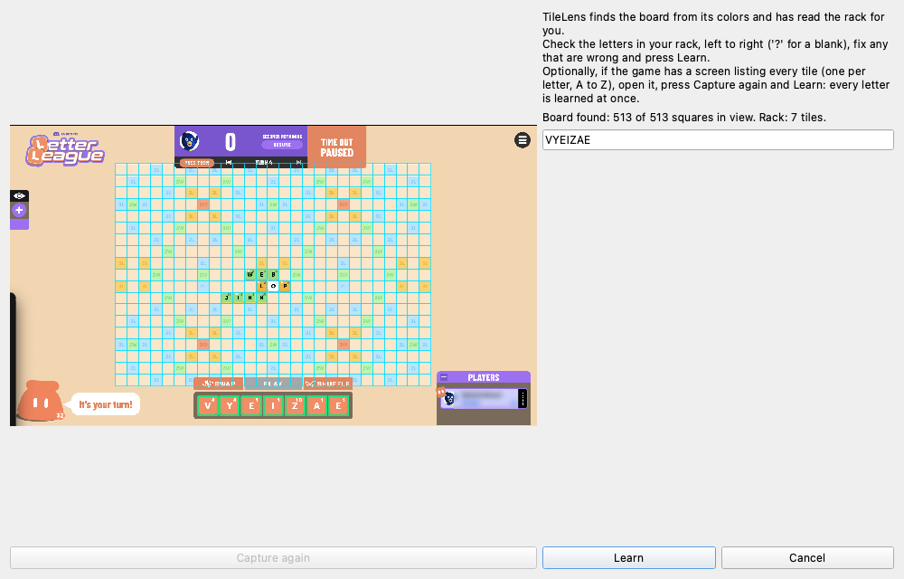

# Using it with Letter League in Discord

1. Start TileLens (`uv run tilelens`) and open the game in Discord, windowed, maximized or
   fullscreen. With a profile that has an `[appearance]` section (see below) there is nothing
   to calibrate: TileLens finds the board, reads the rack and learns the game's look from the
   first screen it sees, and the control window steps out of the way.
2. Play. The panel shows **Tracking** and the top three plays. The first play is previewed on
   the board; click another card to preview that one instead.
3. **Click a card to place it.** The ghost tiles freeze (the panel says **Holding**) so you can
   lay your tiles over them. When your rack is full again with new letters, TileLens reads it
   and resumes by itself. Click the card again, or **Resume tracking**, to let go early.
4. When someone else plays, the old suggestion is dropped at once and the position is searched
   again. Zooming or panning clears the preview and realigns it when the board is found.

The panel states and what to do:

| State | Meaning | What to do |
| --- | --- | --- |
| Tracking | Cards are current for the position on screen | Nothing |
| Aligning | The board moved and is being found again | Nothing |
| Reading rack | The rack or board is still changing | Nothing |
| Calculating | The search is running | Nothing |
| Holding | A card was clicked; the suggestion is frozen | Place your tiles |
| Check one tile | A tile cannot be worked around | Tap the letter it names |
| Board obscured | A menu, popup or window covers the board | Bring the board back into view |
| Paused | You paused tracking | Press Resume |

An unsure tile does not stop the cards: the panel says which tile and shows its best letters as
buttons, and one tap teaches TileLens that tile for good. **Calibrate** re-learns the game from
the screen without typing; only if the rack cannot be read does it open a dialog with the best
guess filled in. The ⚙ button opens the settings window, which is also in the menu bar.



If a play scores differently in the game than in TileLens, run
`uv run tilelens check-screen` while the game is on screen: it prints what was read, the
rack, the top plays and the time each step took. Tile values are read from the rack tiles
themselves and saved beside your profile (`<profile>.learned.json`).

### Without an `[appearance]` section

A profile without it cannot find the board by itself. Select the region, press **Calibrate**,
drag around the board grid, type the board and the rack, and use **Add this screen** to teach
more letters. See [docs/vision.md](vision.md).

## Profile format

Every rule lives in a TOML profile: board size, premium squares, tile values and counts, rack
size, blanks, the full-rack bonus, how word premiums stack, where the first move must go, and
the word list path. No real game's profile ships with TileLens. These two are fictional:

```toml
format = "tilelens-profile"
version = 1
name = "Demo Pocket"

[board]
width = 9
height = 9
layout = [
  "T..d.d..T",
  ".D.....D.",
  "..+...+..",
  "d...t...d",
  "..q...q..",
  "d...t...d",
  "..+...+..",
  ".D.....D.",
  "T..d.d..T",
]

[board.legend]
d = "double_letter"
t = "triple_letter"
D = "double_word"
T = "triple_word"
q = { name = "quad_letter", letter = 4 }
"+" = { name = "double_both", letter = 2, word = 2 }

[rules]
start_squares = [[2, 2], [6, 6]]
word_premium_stacking = "add"

[rack]
size = 5
blanks = 1

[scoring]
full_rack_bonus = 25

[tiles.values]
A = 1
B = 3
# ...

[tiles.distribution]
A = 5
B = 1
# ...

[words]
path = "demo_words.txt"
```

To let TileLens find the board by itself (zoom, pan, fullscreen and no calibration typing),
add the colors of the empty squares and of a rack tile, as shown on your screen:

```toml
[appearance]
rack_tile = "#EF8E66"
squares = { "." = "#FBE6CA", d = "#B7E4FC", t = "#F8D272", D = "#BDF4B2", T = "#F1A27F" }
```

Check a profile with `uv run tilelens check-profile my.toml`. Every key is described in
[docs/profile-format.md](profile-format.md).

## Word list and overrides

TileLens ships no game's word list. Every word a suggestion forms (main word, extension and
crossing words) is checked against a **baseline list** plus **overrides**, small allow and block
lists of words the game was seen to accept or reject, each with its evidence and date. Overrides
win over the baseline and live next to your profile, so replacing the baseline keeps them.

For Letter League the working assumption is the U.S. Merriam-Webster *Official Scrabble Players
Dictionary*, which is **not confirmed** to be what the game uses. The exact list cannot be
shipped here, so `uv run tilelens words install-baseline` installs ENABLE (172,823 words), an
older free Scrabble-style list that is *not* that dictionary and lacks newer words such as QI
and ZA. If you own the exact list, install it with `--file`. See
[docs/word-lists.md](word-lists.md).

```bash
uv run tilelens words status                       # which list, which overrides, which versions
uv run tilelens words block UMU --evidence "game rejected UMU, no other word formed"
uv run tilelens words allow QI --evidence "accepted at J4 on turn 9"
uv run tilelens import-words ~/my-words.txt --profile my.toml   # or bring your own list
```

Copy `profiles/letter-league.overrides.json` (UMU blocked) next to your profile as
`<profile name>.overrides.json` to start from it.
